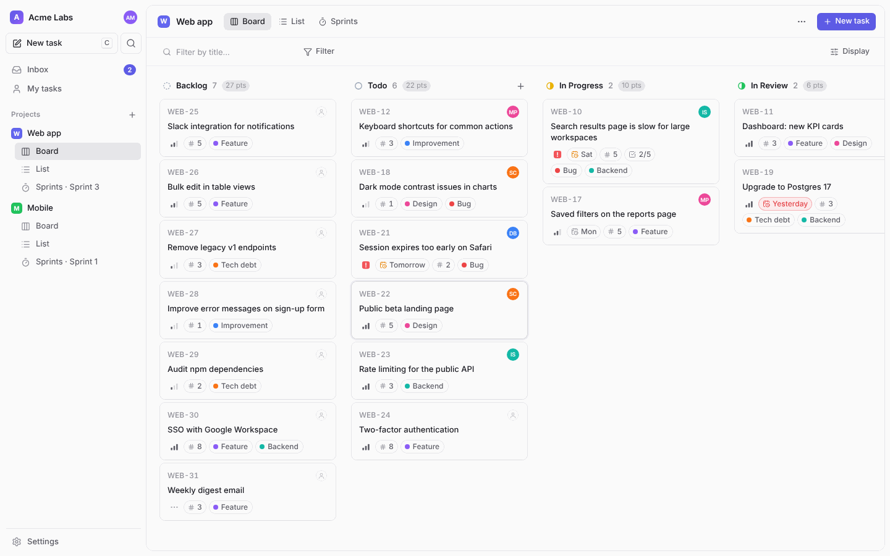
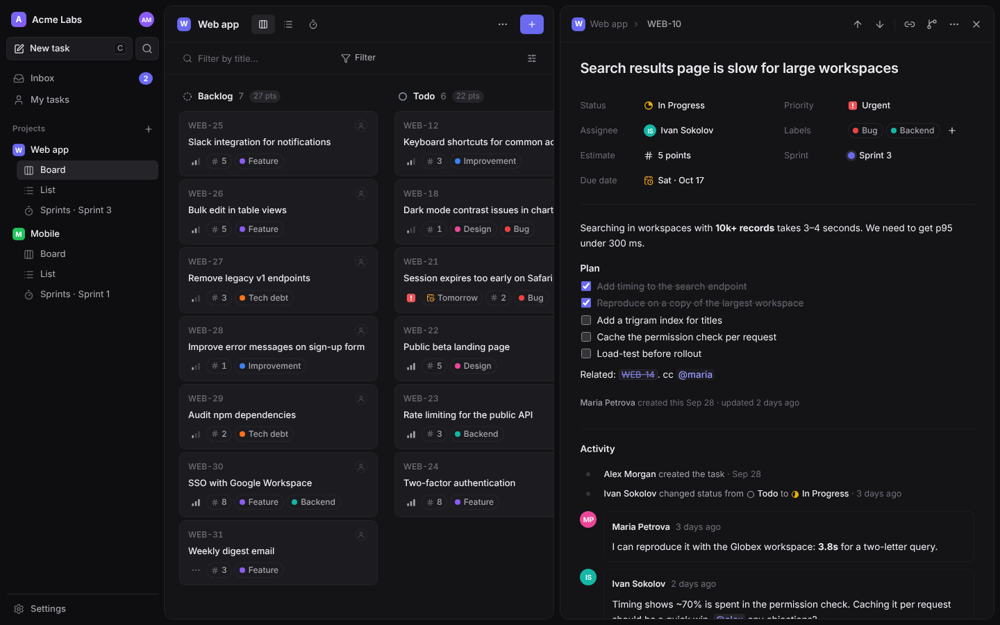
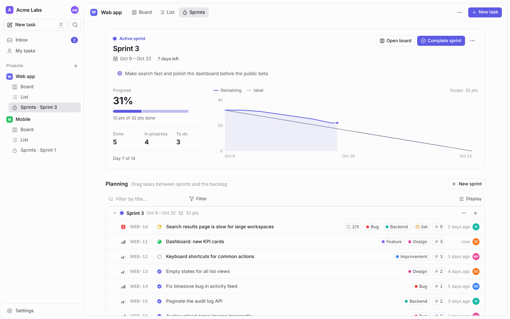

# tackle
Tackle is a lightweight issue tracker built for small teams and early-stage startups. You get the essentials (tasks, a board and simple sprints) without the setup, permission schemes and endless settings of enterprise tools. Open it, add your work, and start tackling it.



<table>
  <tr>
    <td></td>
    <td></td>
  </tr>
</table>

## Why Tackle

- **Instant.** The whole workspace is loaded into the browser once; filtering, grouping and navigation never wait for the network. Every change is applied optimistically and synced in the background.
- **Live.** Teammates see each other's changes immediately (Server-Sent Events), no refresh needed.
- **Keyboard-first.** `⌘K` command menu, `C` to create, `J`/`K` to move, `S` `P` `A` `L` `E` `D` to change properties of the selected or open task. Works with any keyboard layout, including Cyrillic.
- **Tiny to run.** One Node.js process and one SQLite file. The production server is a single bundled file with zero runtime dependencies; the client is ~60 KB gzipped.
- **Opinionated, not configurable to death.** Sensible defaults for statuses, priorities and labels — change them if you need to, ignore them if you don't.

## Features

**Tasks** — short ids per project (`WEB-42`), status, priority (urgent → low), assignee, labels, story points, due date, sprint. Markdown descriptions with clickable checklists, task references (`WEB-12` becomes a link) and `@mentions`. Full activity history (rapid edits are merged, so dragging a card around doesn't spam it) and comments.

**Views** — Kanban board with drag and drop (mouse and touch), list view grouped by status, assignee, priority, sprint or label, *My tasks* across all projects. Filters (status, assignee, priority, label, sprint, text) and display options are remembered per view. Completed tasks older than two weeks are tucked away automatically so boards stay clean.

**Sprints** — plan by dragging tasks between sprints and the backlog, start a sprint, track progress and a burndown chart, complete it and carry unfinished work over to the next sprint (or a new one, or the backlog) in one step.

**Team** — invite links (no email server needed), admin/member roles, password reset links, deactivating members. Inbox with notifications when you are assigned, mentioned, or when someone comments on or moves your tasks.

**Polish** — light and dark themes, English and Russian UI, bulk edit for multi-selected tasks, undo for deletions, copy task link / git branch name (`web-42-fix-login`), works on phones and can be added to the home screen.

## Quick start

Requires **Node.js 22.13+** (Tackle uses the built-in `node:sqlite`, so nothing needs compiling).

```bash
npm install
npm run build
npm start            # http://localhost:3000
```

Open the app and the setup wizard creates your workspace, admin account and first project.

Want to look around first? Load the demo workspace (sign in as `alex@tackle.dev` / `demo1234`):

```bash
npm run seed         # add -- --force to replace an existing database
```

### Docker

```bash
docker compose up -d
```

The database lives in the `tackle-data` volume (`/data/tackle.db` inside the container).

### Configuration

| Variable | Default | Description |
| --- | --- | --- |
| `PORT` | `3000` | HTTP port |
| `HOST` | `0.0.0.0` | Interface to bind |
| `DATA_DIR` | `./data` | Directory for the database |
| `DATABASE_PATH` | `$DATA_DIR/tackle.db` | Full path to the SQLite file |
| `SECURE_COOKIES` | `auto` | `auto` marks the session cookie `Secure` when the request came over HTTPS (or `X-Forwarded-Proto: https`); `true`/`false` to force |
| `SESSION_DAYS` | `30` | Session lifetime |

Put Tackle behind any reverse proxy (Caddy, nginx, Traefik) for HTTPS. Server-Sent Events need response buffering disabled for `/api/events` — Tackle sends `X-Accel-Buffering: no`, which nginx honours.

### Backups

All data is in one SQLite file. Copy it (with `sqlite3 tackle.db ".backup backup.db"` for a consistent snapshot while running) or download a JSON export from *Settings → Data*.

## Keyboard shortcuts

| Keys | Action |
| --- | --- |
| `⌘K` / `Ctrl K` | Command menu: search tasks, run any action |
| `C` | Create task |
| `/` | Filter the current view |
| `J` `K` / `↑` `↓`, `←` `→` | Move between tasks / board columns |
| `Enter` | Open task |
| `X`, `⇧↑` `⇧↓`, `⌘A` | Select, extend selection, select all |
| `S` `P` `A` `L` `E` `D` `⇧S` | Status, priority, assignee, labels, estimate, due date, sprint |
| `I` | Assign to me |
| `⌘⌫` | Delete |
| `G` then `M` / `I` / `B` / `L` / `S` / `,` | My tasks, inbox, board, list, sprints, settings |
| `?` | All shortcuts |

## Development

```bash
npm run dev          # API on :3000 with auto-reload + Vite on :5173
npm run typecheck
npm test             # unit + API tests (node:test)
npm run test:e2e     # end-to-end tests in Chromium (Playwright)
```

Project layout:

```
server/        Hono API, SQLite schema & migrations, auth, realtime hub, demo seed
shared/        Types and constants used by both sides
src/           Preact client
  store/       In-memory data (signals), optimistic actions, SSE sync
  lib/         Router, hotkeys, i18n, markdown, drag & drop, view logic
  components/  Board, list, task panel, pickers, command menu, dialogs…
  pages/       Project views, sprints, inbox, my tasks, settings, auth
tests/         unit/, api/, e2e/
```

See [docs/DESIGN.md](docs/DESIGN.md) for the reasoning behind the architecture and the products that inspired it.

## License

[MIT](LICENSE)
